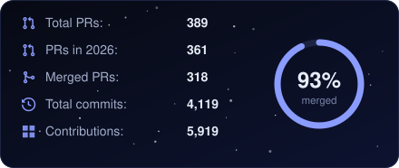

<h3 align="center">Hi, I'm Garvit. I like taking products from an idea to something people use every day.</h3>

  
  
  

---

- 🚀 Founding engineer at Wavelength (YC W24), building AI-driven products end to end.
- 🌱 In the past, have worked in a variety of business domains like developer tools and platforms, cybersecurity.
- 🛠️ On the side, I build small local-first tools I wish existed. No accounts, no tracking.
- 🔭 Outside of work, you'll find me travelling or having a nice coffee somewhere

 

<table>
<tr>
<td valign="top" width="50%">

### GitHub stats

</td>
<td valign="top" width="50%">

### Side projects

- [**usage-rings**](https://github.com/garvitkhandelwal/usage-rings): close your rings, not your rate limits. Your AI plan usage, live in the menu bar.
- [**Slate**](https://github.com/garvitkhandelwal/Slate): a weekly planner for people who don't want a productivity system.

### Writing

<!-- writing:start -->
- [Understanding Hydration in React & Next.js](https://garvitkhandelwal.com/blog/understanding-hydration-react-nextjs) · Feb 2026
<!-- writing:end -->

</td>
</tr>
</table>
