<a href="https://www.garvitkhandelwal.com">
  
</a>

<p align="center">
  <a href="https://www.garvitkhandelwal.com"><b>garvitkhandelwal.com</b></a>
  &nbsp;·&nbsp;
  <a href="https://x.com/garvit_kh">@garvit_kh</a>
</p>

<br />

### `~ % cat about.md`

I'm a **founding engineer** at Wavelength (YC W24). I like the zero-to-one part: an empty repo, a fuzzy idea, and a product that real people use a few weeks later.

I learned to build in public. My first PRs went to open source communities in college, and I still work that way: small changes, shipped often.

```txt
now          → building Wavelength from the ground up, end to end
before       → open source at FOSSASIA, and a competitive programming habit
side quests  → small, opinionated tools I wish existed (local-first, no accounts, no tracking)
how i work   → ship small, merge fast, sweat the last 5%
peak hours   → late. very late.
off-screen   → travelling · staring at the night sky · falling down mystery rabbit holes
```

<br />

### `~ % cd ~/analytics`




<br />

<p align="center">
  <sub>
    Every number above comes from my real GitHub activity, private work included.<br />
    <a href="./scripts/generate.py">scripts/generate.py</a> renders the cards, and a GitHub Action refreshes them every day.
  </sub>
</p>
